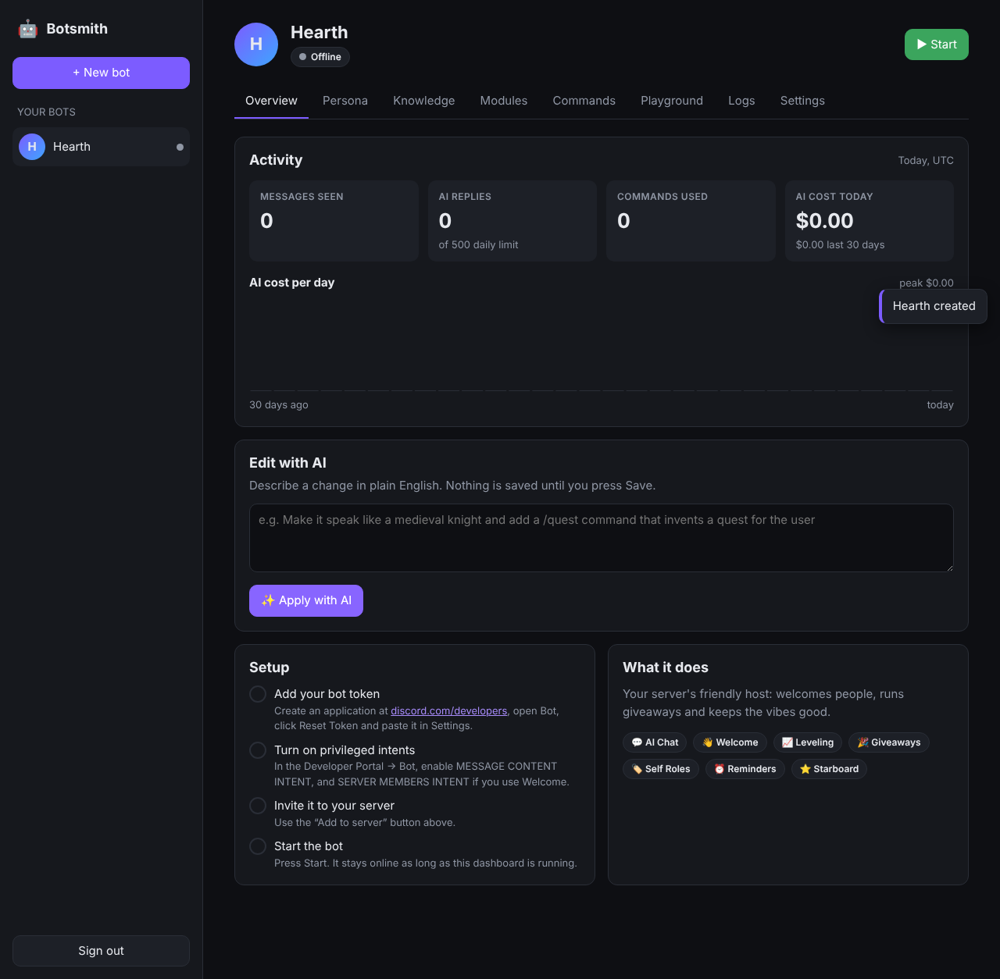

# Botsmith: Discord AI bot builder

Describe a Discord bot in plain English. The AI writes its personality, switches on the modules it
needs and creates its slash commands. You fine-tune everything in a web dashboard and press **Start**,
and the bot runs 24/7 for as long as the server is up.



## What a bot can do

| Module | What it does | Commands |
|---|---|---|
| 💬 AI Chat | Talks in its persona when @mentioned, in DMs, or in "always-on" channels. Remembers the conversation, can **search the web** and **see images** | `/ask` `/reset` |
| 🧠 Knowledge base | Paste or upload FAQs, rules and docs; the bot answers from them (prompt-cached, so big docs stay cheap) | — |
| ⚡ Auto Replies | Trigger → reply rules (contains / exact / starts with / regex), optionally AI-written | — |
| 🛡️ Moderation | Banned words, invite/link blocking, anti-spam, AI moderation; delete, warn or time out; mod log | `/warn` `/warnings` `/timeout` `/purge` |
| 👋 Welcome | Greets new members (fixed template or AI-written) and gives an auto-role | — |
| 📈 Leveling | XP for chatting, level-up messages, role rewards | `/rank` `/leaderboard` |
| 🎫 Tickets | Private support channels for the member and staff | `/ticket open` `/ticket close` |
| 🎉 Giveaways | Button-entry giveaways that end on their own | `/giveaway start/end/reroll` |
| 🪙 Economy | Server currency | `/balance` `/daily` `/work` `/pay` `/richest` |
| 🏷️ Self Roles | Button panels members click to give themselves roles | `/selfroles` |
| ⏰ Reminders | Personal reminders that survive restarts | `/remind` `/reminders` |
| 📜 Server Log | Joins, leaves, deleted and edited messages in a log channel | — |
| ⭐ Starboard | Reposts messages that collect enough ⭐ reactions | — |
| ✨ Custom commands | Your own slash commands: fixed text, or a prompt the AI answers in persona | anything |

Every bot also gets `/help`. Channels and roles can be set by **name** (`welcome`, `Moderators`) or by ID,
which is how the AI builder can wire things up without knowing your server's IDs.

The dashboard also has:
- **6 templates** (Community Manager, Support Desk, Moderation Guardian, Study Buddy, Gaming Hype, Roleplay Character). They work even before you add an AI key.
- **Edit with AI**: "make it talk like a knight and add a /quest command" turns into a reviewed draft you can save.
- **Playground**: chat with the persona, including unsaved edits, without touching Discord.
- **Activity and cost**: messages, AI replies, commands and estimated AI spend per day, with a **daily AI reply cap** per bot.
- **Discord profile sync**: push the bot's name and avatar to Discord from the dashboard.
- **Own the code**: download any bot as a standalone Node.js project (with README and Dockerfile) that runs without Botsmith.
- **Live logs**, **duplicate**, and JSON **export/import**. Exports never include the token.

## Quick start

You need Node.js 20+, an [Anthropic API key](https://console.anthropic.com) and a Discord application.

```bash
npm install
cp .env.example .env     # then set ANTHROPIC_API_KEY, ADMIN_PASSWORD and SECRET_KEY
npm start                # → http://127.0.0.1:3000
```

Then in the dashboard:

1. **+ New bot** → describe it → **Build with AI** (or start from scratch).
2. Create an application at <https://discord.com/developers/applications>. Under **Bot**, click **Reset Token**, copy it and paste it into the bot.
3. On the same **Bot** page, turn on **Message Content Intent**, plus **Server Members Intent** if you use Welcome or member logging.
4. Click **Add to server** in the dashboard to invite the bot with the right permissions, then **Start**.

Changes you save apply to a running bot immediately. If a change needs different gateway intents, the
bot reconnects on its own.

## Run it 24/7

Anything that runs Node and keeps a disk works: a VPS, Railway, Fly.io or a home server.

```bash
docker build -t botsmith .
docker run -d --restart unless-stopped -p 127.0.0.1:3000:3000 \
  --env-file .env -v botsmith-data:/data botsmith
```

Bots that were running when the server stopped start again automatically when it comes back.
If you expose the dashboard beyond localhost, put it behind HTTPS (Caddy, nginx or Cloudflare Tunnel)
and set `SECURE_COOKIES=true`.

## AI models and cost

The overview tab estimates spend from token usage, and every bot has a daily AI reply cap (500 by
default). Each bot picks its own model on the Persona tab: Claude Opus 5.5 (default, smartest), Sonnet 5.5
(balanced) or Haiku 5.5 (fastest, cheapest). It also picks a thinking effort level. The AI builder
uses Opus 5.5, and AI moderation uses Haiku 5.5 because it runs on every message. Set a monthly
spend limit in the Anthropic console.

## Security

- The dashboard is password-protected and only listens on `127.0.0.1` by default. Login attempts are rate-limited and sessions are HMAC-signed httpOnly cookies.
- Discord tokens are encrypted at rest (AES-256-GCM, with the key derived from `SECRET_KEY`) and are never sent back to the browser. If you change `SECRET_KEY`, you have to paste the tokens again.
- Bot replies can't ping `@everyone`, `@here` or roles, whatever the AI writes.
- Everything is stored as JSON files in `DATA_DIR`. Back that folder up.

## Project layout

```
src/server.js          dashboard API + static files
src/ai.js              Claude: bot chat, the AI builder (structured output), AI moderation
src/schema.js          the bot spec: one JSON document per bot, validated with zod
src/manager.js         starts/stops bots, status, logs
src/runtime/bot.js     one discord.js client per bot; routes messages and commands to modules
src/runtime/modules/   ai-chat, auto-replies, moderation, welcome, leveling, tickets, giveaways, economy,
                       self-roles, reminders, logging, starboard, custom-commands
src/templates.js       ready-made bots
src/standalone.js      runs one exported bot without the dashboard
src/zip.js             builds the "own the code" download
public/                the dashboard (vanilla JS, no build step)
```

`npm test` runs the unit tests.

## Not included (yet)

- **Music**: it needs voice, ffmpeg and a legal audio source, so it's left out on purpose.
- **Multiple users**: this is a single-owner dashboard. Letting other people sign up and host their bots on your server would need accounts, per-user isolation and billing.
